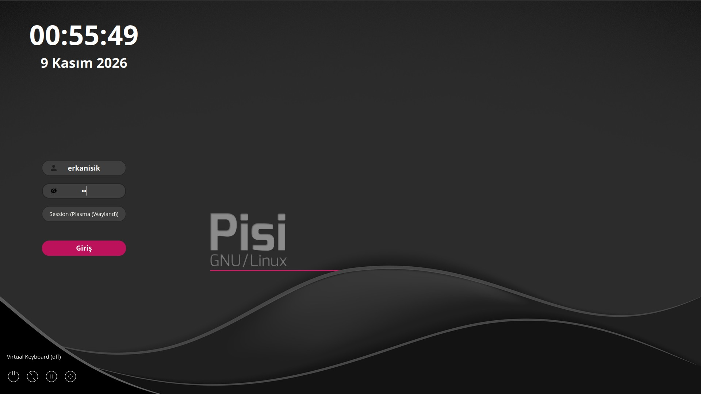

# sddm-pisilinux24


**sddm-pisilinux24**, [PisiLinux](https://www.pisilinux.org/) için hazırlanmış bir [SDDM](https://github.com/sddm/sddm/) giriş temasıdır.

Tema, **[Keyitdev](https://github.com/Keyitdev)** tarafından geliştirilen [sddm-astronaut-theme](https://github.com/Keyitdev/sddm-astronaut-theme) projesinden uyarlanmıştır. Orijinal projenin Qt6 tabanlı altyapısı, sanal klavye desteği ve yapılandırma yaklaşımı korunmuş; görünüm PisiLinux kimliğine göre yeniden düzenlenmiştir.

Tema Qt6 ile yazılmıştır. Sanal klavye desteği, animasyonlu arka plan desteği ve tek dosyadan yönetilebilen bir yapılandırma sunar. Görünümü değiştirmek için yalnızca kök dizindeki [pisi.conf](./pisi.conf) dosyasını düzenlemek yeterlidir.

## Önizleme



## Özellikler

- PisiLinux renk paleti ve arka planı ile uyumlu giriş ekranı
- Qt6 tabanlı SDDM teması
- Sanal klavye desteği
- Animasyonlu arka plan (video ve GIF) desteği
- Kullanıcı adı ve oturum seçimi için açılır liste
- Şifre alanının altında konumlandırılmış oturum seçici
- Tek yapılandırma dosyası ile kolay özelleştirme

## Kurulum

### 1. Bağımlılıkları kurun

SDDM ve Qt6 bileşenlerinin kurulu olması gerekir:

```sh
sudo pisi it sddm qt6 qt6-svg qt6-virtualkeyboard qt6-multimedia
```

> Paket adları PisiLinux sürümüne göre farklılık gösterebilir. Eksik bir paket bildirilirse depodaki güncel adını kullanın.

Video arka planlar için ek codec paketleri (örneğin H.264) gerekebilir.

### 2. Temayı kopyalayın

```sh
sudo mkdir -p /usr/share/sddm/themes/sddm-pisilinux24
sudo cp -r Assets Backgrounds Components Fonts Previews \
  Main.qml metadata.desktop pisi.conf LICENSE \
  /usr/share/sddm/themes/sddm-pisilinux24/
```

### 3. Fontları kurun

```sh
sudo cp -r /usr/share/sddm/themes/sddm-pisilinux24/Fonts/* /usr/share/fonts/
sudo fc-cache -f
```

### 4. SDDM'i temaya yönlendirin

```sh
echo "[Theme]
Current=sddm-pisilinux24" | sudo tee /etc/sddm.conf
```

### 5. Sanal klavyeyi etkinleştirin

```sh
sudo mkdir -p /etc/sddm.conf.d
echo "[General]
InputMethod=qtvirtualkeyboard" | sudo tee /etc/sddm.conf.d/virtualkbd.conf
```

### 6. SDDM'i yeniden başlatın

```sh
sudo systemctl restart sddm
```

## Önizleme (oturum kapatmadan)

Temayı oturum kapatmadan test edebilirsiniz:

```sh
sddm-greeter-qt6 --test-mode --theme /usr/share/sddm/themes/sddm-pisilinux24/
```

> Sistem yapılandırmasına bağlı olarak önizleme, gerçek giriş ekranından küçük farklılıklar gösterebilir.

## Özelleştirme

Tüm görünüm ayarları kök dizindeki [pisi.conf](./pisi.conf) dosyasında bulunur:

- **Arka plan:** `Background="Backgrounds/pisi.jpg"`
- **Renkler:** giriş alanları, butonlar, oturum seçici ve açılır liste renkleri
- **Ölçekleme:** Ekran boyutu `ScreenWidth`, `ScreenHeight` ve yazı boyutu `FontSize` ile sabitlenebilir. Bu üç değer boş bırakıldığında tema, gerçek ekran çözünürlüğüne göre kendini ölçekler; küçük ekranlarda düzen bozulmaz.
- **Sistem butonları:** Shutdown / Reboot / Suspend / Hibernate butonları formun sol altına sabitlenir (`FormPosition="left"` iken ekranın sol altı). Arka plan rengi `SystemButtonsBackgroundColor` ile ayarlanır.
- **Form konumu:** `FormPosition="left"` (left, center, right)
- **Bulanıklık:** `PartialBlur`, `FullBlur`, `Blur`, `BlurMax`
- **Davranış:** `HideLoginButton`, `HideSystemButtons`, `PasswordFocus`, `UseRealName`
- **Çeviriler:** `TranslatePlaceholderUsername`, `TranslateSessionSelection` ve diğerleri

Değişikliklerin ardından SDDM'i yeniden başlatın veya önizleme komutunu tekrar çalıştırın.

Tema seçimi [metadata.desktop](./metadata.desktop) dosyasındaki şu satırla yapılır:

```
ConfigFile=pisi.conf
```

## Kaynaklar ve atıf

Bu proje, aşağıdaki açık kaynak projeye dayanmaktadır:

- **sddm-astronaut-theme** — [Keyitdev](https://github.com/Keyitdev) tarafından geliştirilmiştir.
  - Depo: https://github.com/Keyitdev/sddm-astronaut-theme
  - Lisans: GPLv3+
  - Orijinal tema, [MarianArlt](https://github.com/MarianArlt/sddm-sugar-dark)'ın sddm-sugar-dark projesinden türetilmiştir.

Temada kullanılan üçüncü taraf varlıklar:

- **Open Sans** fontu — [Google Fonts](https://fonts.google.com/specimen/Open+Sans/about)
- **PisiLinux arka plan görseli** — PisiLinux projesine aittir
- Diğer fontlar ve görseller orijinal sddm-astronaut-theme projesinden gelmektedir; ilgili sanatçı ve lisans bilgileri orijinal projenin [README](https://github.com/Keyitdev/sddm-astronaut-theme#sources) dosyasında listelenmiştir.

## Lisans

Bu proje **[GPLv3+](https://www.gnu.org/licenses/gpl-3.0.html)** lisansı altında dağıtılmaktadır.

Orijinal çalışma: Copyright (C) 2022-2025 Keyitdev.  
PisiLinux uyarlaması: Copyright (C) erkanisik ve katkıda bulunanlar.
